# PTDL_2025: Phân tích các yếu tố ảnh hưởng đến mức độ hài lòng của khán giả đối với phim điện ảnh: Nghiên cứu trên tập dữ liệu MovieLens và TMDB

## Thành viên nhóm:
**-** Võ Thị Thương - 3122410408

**-** Trần Duy Khương - 3122410192

**-** Nguyễn Vũ Hào - 3122410098

---

## I. Khám phá dữ liệu (EDA)

### 1. Phân tích biến mục tiêu

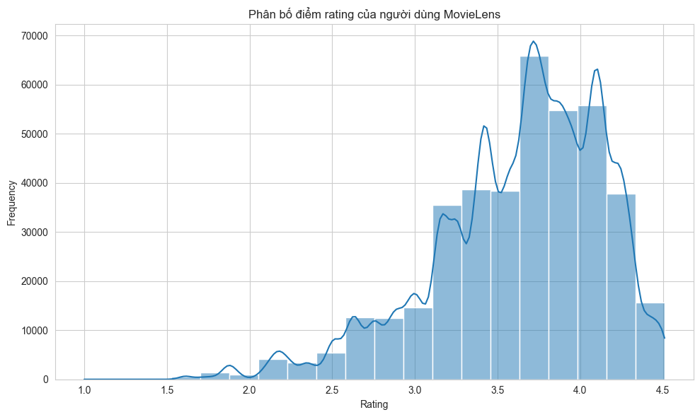

Biểu đồ phân bố điểm rating cho thấy dữ liệu có xu hướng lệch trái rõ rệt với tần suất rất thấp ở các mức điểm thấp từ 1.0 đến 2.5 và tăng mạnh ở các mức điểm cao. Phần lớn đánh giá tập trung trong khoảng 3.0 đến 4.5, trong đó đỉnh cao nhất nằm tại mức 4.0 với số lượng áp đảo, tiếp theo là các mức 3.0 và 3.5. Đường cong mật độ bám sát histogram và dao động theo các mốc điểm nguyên và bán nguyên, phản ánh thói quen người dùng thường tập trung chấm điểm ở những giá trị quen thuộc. Kết quả thống kê mô tả cũng chỉ ra điểm trung bình đạt 3.63, cho thấy tâm lý người dùng thường có xu hướng xem những phim phù hợp sở thích nên chấm điểm khá hào phóng, các phim dở thường bị bỏ qua thay vì bị chấm điểm thấp.

### 2. Phân tích các biến định lượng và phân loại

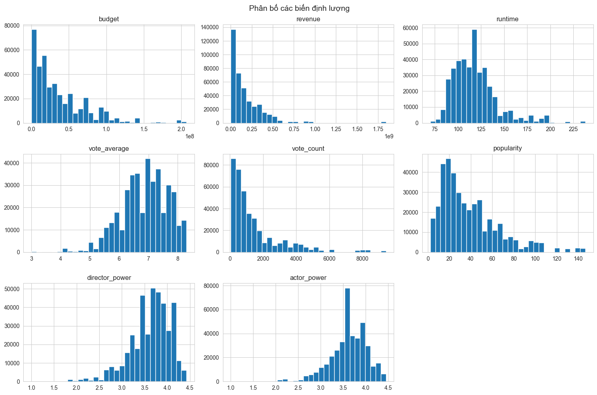

Đối với các biến định lượng, chúng ta thấy sự phân hóa rõ rệt thành hai nhóm. Nhóm biến tài chính và phổ biến bao gồm budget, revenue và vote_count đều có phân bố lệch phải rất mạnh. Phần lớn phim nằm ở mức thấp đến trung bình, trong khi chỉ một số ít phim bom tấn tạo ra phần đuôi dài, phản ánh đặc trưng "Winner-takes-all" của ngành điện ảnh. Ngược lại, nhóm biến nội dung và nhân sự như runtime, director_power và actor_power lại có phân bố tập trung hơn, gần dạng hình chuông. Thời lượng phim chủ yếu dao động từ 90 đến 130 phút, trong khi sức mạnh của đạo diễn và diễn viên tập trung quanh giá trị trung bình, chỉ một số ít đạt mức ảnh hưởng vượt trội.

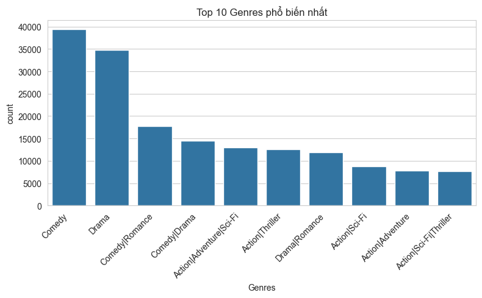

Biểu đồ phân bố thể loại cho thấy sự mất cân bằng lớn trong dữ liệu khi Comedy và Drama chiếm tỷ trọng áp đảo với hàng chục nghìn phim, trong khi các thể loại phức hợp lại xuất hiện rất ít. Khi xem xét mối quan hệ giữa đẳng cấp đạo diễn và điểm số, ta thấy nhóm đạo diễn "Huyền thoại" (Legendary) có độ lệch chuẩn thấp và điểm số tập trung ở mức cao, tạo nên một "tấm khiên" bảo chứng chất lượng. Ngược lại, nhóm đạo diễn vô danh (Low) có biên độ điểm số dao động rất lớn, phim của họ có thể bị đánh giá rất thấp nếu chất lượng không đạt yêu cầu.

### 3. Tương quan và các yếu tố nhân khẩu học
Ma trận tương quan làm nổi bật vai trò của yếu tố con người trong điện ảnh. Biến Director Power có hệ số tương quan dương cao nhất (0.87), theo sau là Actor Power (0.78), khẳng định uy tín của ê-kíp sản xuất là yếu tố dự báo mạnh mẽ nhất cho chất lượng phim. Ngược lại, các yếu tố tài chính như doanh thu hay ngân sách lại có mối liên hệ rất yếu, thậm chí là tiêu cực nhẹ đối với điểm đánh giá, cho thấy tiền bạc không đảm bảo mua được sự hài lòng của khán giả MovieLens.

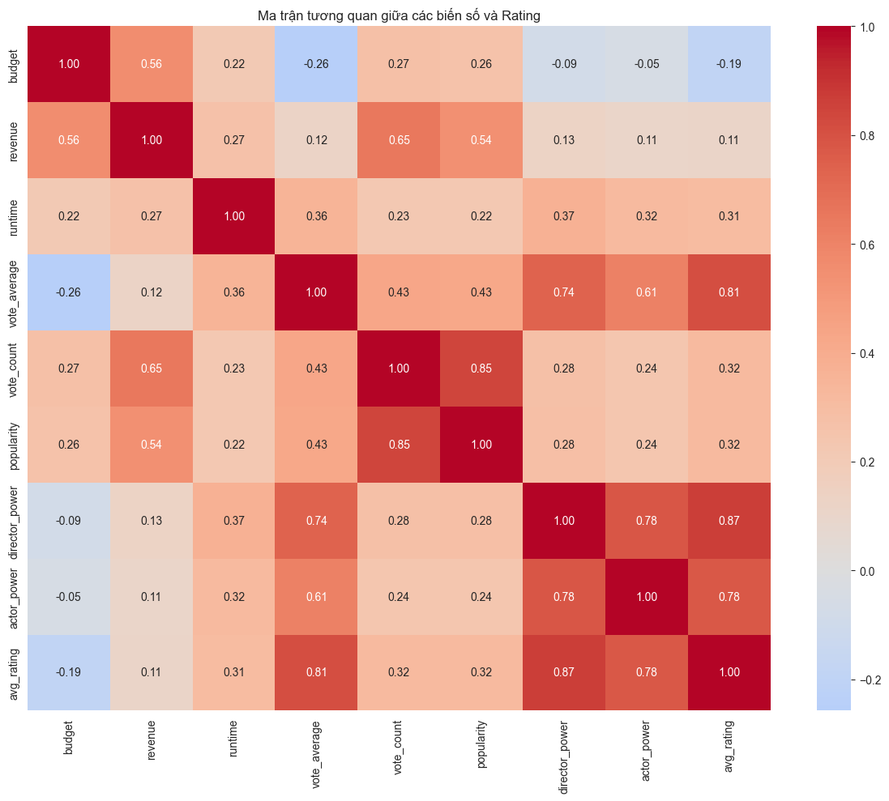

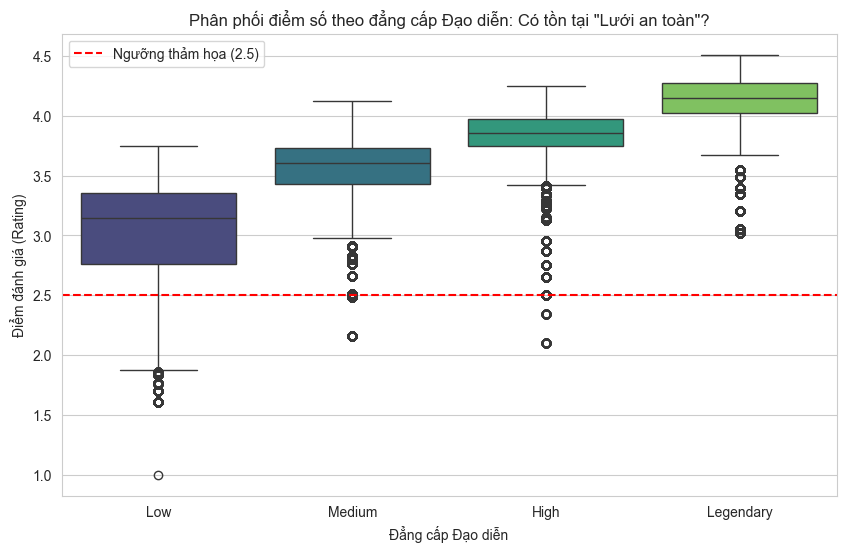

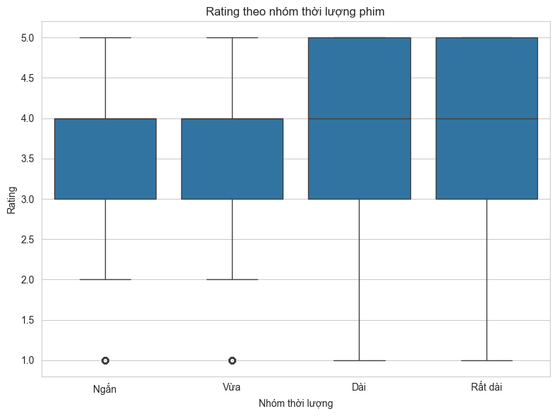

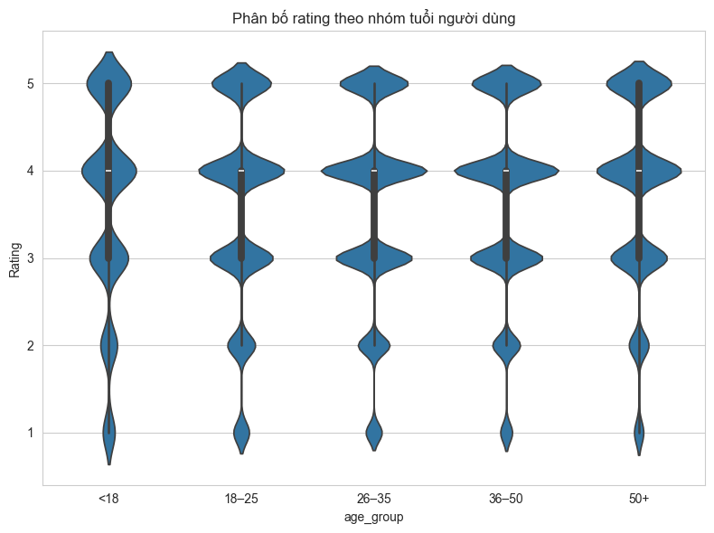

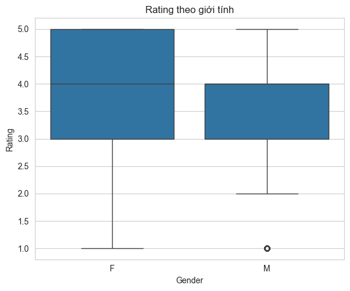

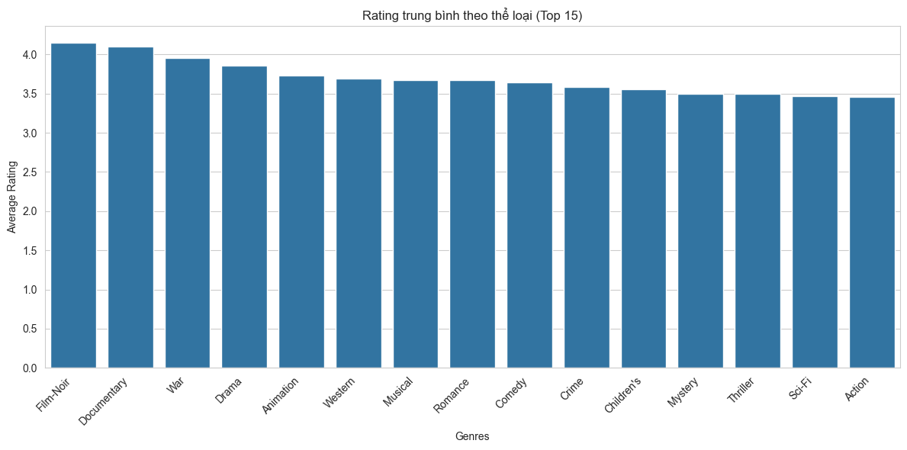

Khi phân tích theo nhân khẩu học và thời lượng, dữ liệu cho thấy nhóm phim dài và rất dài thường có trung vị điểm số cao hơn (xấp xỉ 4.0) so với nhóm phim ngắn, phản ánh sự ưu ái của khán giả dành cho các tác phẩm có chiều sâu nội dung. Về phía người dùng, độ tuổi không tạo ra sự khác biệt lớn trong hành vi chấm điểm khi trung vị đều ổn định ở mức 4.0. Tuy nhiên, yếu tố giới tính cho thấy nữ giới có xu hướng hào phóng hơn và phân cực hơn trong đánh giá, trong khi nam giới lại tỏ ra thận trọng và khắt khe hơn với các điểm số tập trung chủ yếu ở mức khá.

### 4. Tương tác đa biến

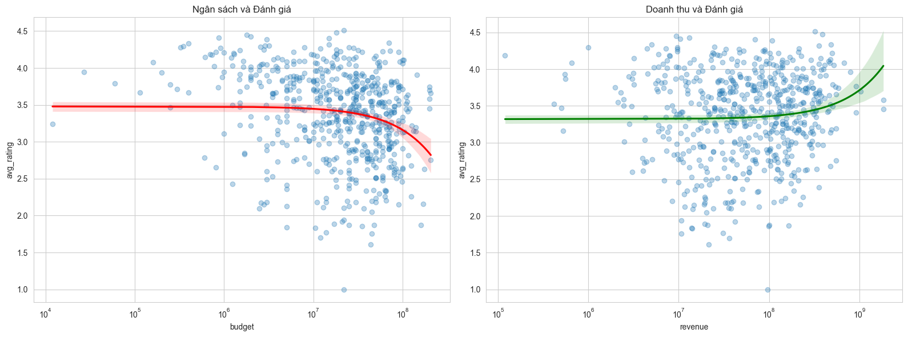

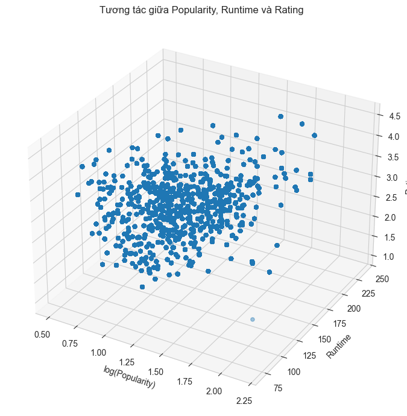

Sự tương tác giữa độ phổ biến, thời lượng và rating vẽ nên một bức tranh thú vị về "lưới an toàn" của sự nổi tiếng. Biểu đồ cho thấy các phim có độ phổ biến cao hiếm khi bị chấm điểm quá thấp, dù không đảm bảo sẽ xuất sắc. Những "siêu phẩm" có điểm trên 4.0 thường hội tụ ở khung thời lượng 100-150 phút nhưng độ phổ biến lại trải dài, chứng tỏ phim hay tuyệt đối có thể là bom tấn hoặc những viên ngọc ẩn ít người biết.

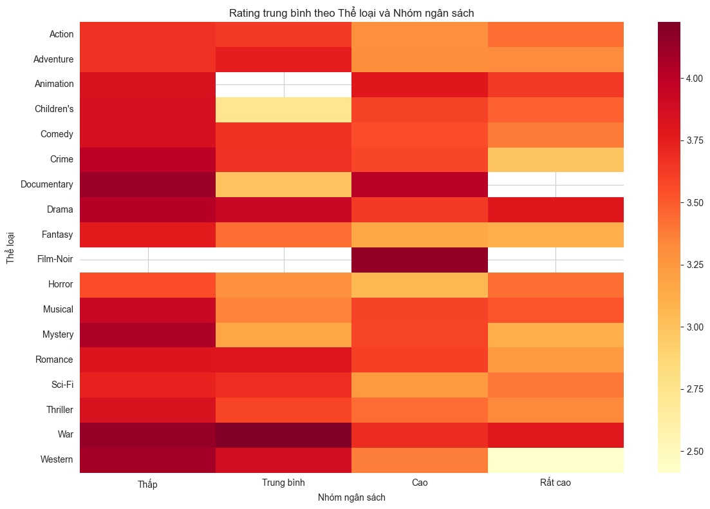

Biểu đồ nhiệt về mối quan hệ giữa Thể loại và Ngân sách đã làm rõ vai trò của dòng tiền. Đối với nhóm phim Drama hay Comedy, quy luật hiệu suất giảm dần hiện rõ khi ngân sách thấp thường mang lại điểm cao nhất, còn sự phô trương kinh phí lại kéo chất lượng đi xuống. Ngược lại, ở các thể loại như Action hay Animation, ngân sách lớn đóng vai trò là "nhiên liệu" duy trì sàn chất lượng kỹ thuật, giúp phim thoát khỏi vùng đánh giá kém.

---

## II. Phân tích chuyên sâu

### 1. Các yếu tố tài chính: Nghịch lý của dòng tiền

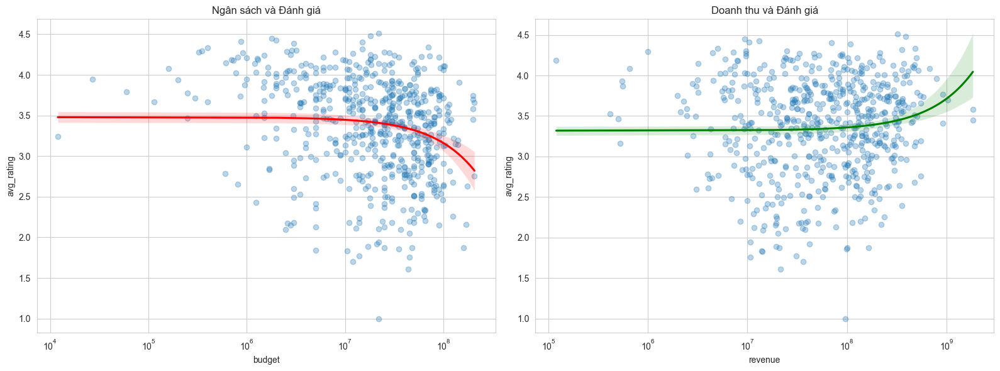

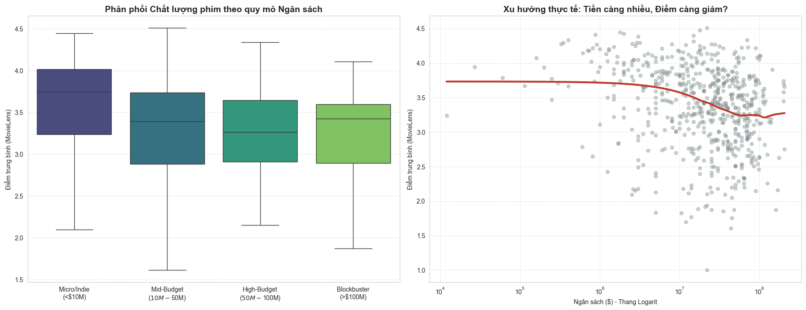

Kết quả phân tích hồi quy cho thấy một nghịch lý rõ rệt: ngân sách càng cao, điểm đánh giá trung bình lại có xu hướng giảm nhẹ (-0.19). Biểu đồ Scatter với đường cong LOWESS minh họa mối quan hệ phi tuyến tính này, nơi điểm đánh giá đạt đỉnh ở nhóm ngân sách thấp (dưới 10 triệu USD) và giảm dần khi bước sang nhóm phim thương mại hóa cao hơn. Điều này khẳng định khán giả MovieLens đề cao giá trị nội dung và diễn xuất của dòng phim độc lập hơn là quy mô sản xuất hoành tráng.

#### Phân cụm và Hồi quy theo nhóm phim (K-Means Clustering)

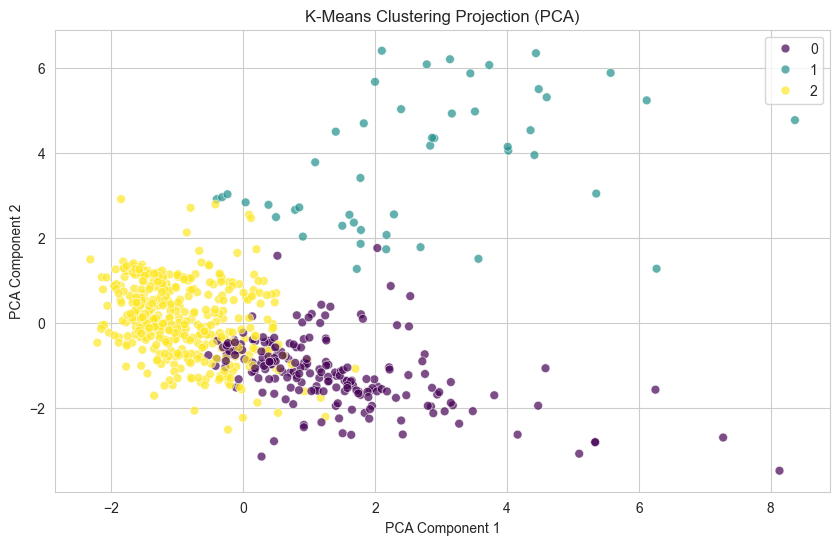

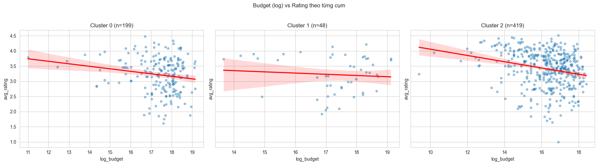

Để hiểu rõ hơn, chúng tôi sử dụng thuật toán K-Means chia dữ liệu thành 3 cụm đặc trưng. Cụm 2 đại diện cho phim ngân sách thấp nhưng chất lượng cao; Cụm 1 là nhóm bom tấn kinh phí khổng lồ; và Cụm 0 là nhóm phim kinh phí thấp ít tiếng vang. Kết quả hồi quy tuyến tính trên từng cụm đều cho thấy hệ số góc âm hoặc gần như bằng 0, củng cố luận điểm rằng việc tăng ngân sách không đảm bảo cải thiện rating, thậm chí gây tác dụng ngược rõ rệt nhất ở nhóm phim tâm lý/nghệ thuật (Cụm 2).

*Chi tiết phân phối phần dư (Residuals) của từng cụm:*

Cluster 0:

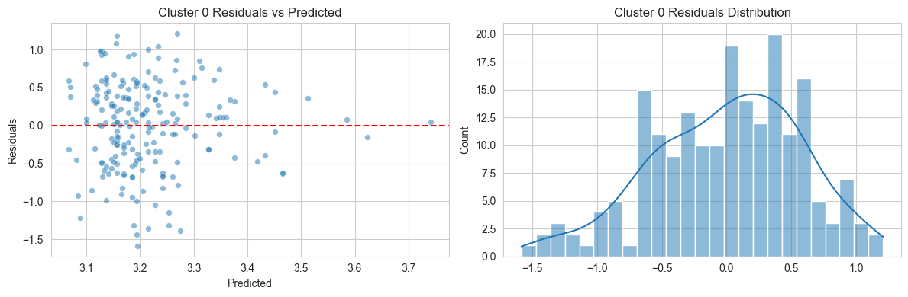

*Cluster 0 (Phim ngân sách thấp, ít người xem): Phân khúc phim giá rẻ, chất lượng sản xuất hạn chế.*

Cluster 1:

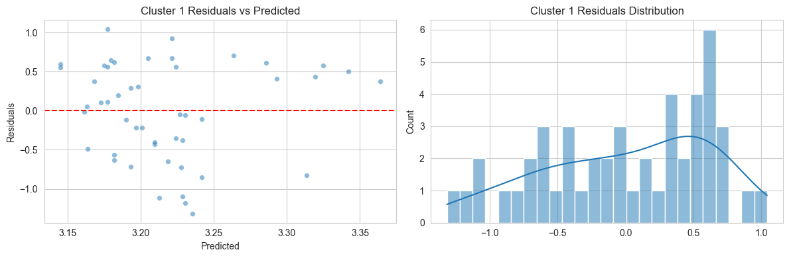

*Cluster 1 (Phim bom tấn): Nhóm phim hành động, viễn tưởng với ngân sách và doanh thu cao nhất, rating ổn định nhưng không đột phá.*

Cluster 2:

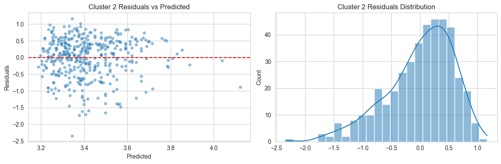

*Cluster 2 (Phim Mid-budget chất lượng cao): Nhóm phim Drama, Thriller được đánh giá cao nhất nhờ kịch bản tốt.*

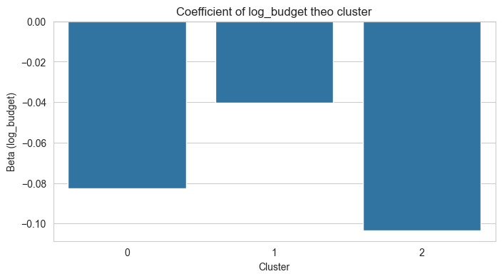

Biểu đồ so sánh hệ số Beta cho thấy Cụm 2 có hệ số âm lớn nhất, nghĩa là tác động tiêu cực của việc "vung tiền" lên rating là rõ ràng nhất ở nhóm này. Trong khi đó, ở Cụm 1 (bom tấn), hệ số này nhỏ hơn, cho thấy khán giả của dòng phim giải trí dễ chấp nhận sự đầu tư lớn về kỹ xảo hơn, dù nó không giúp tăng điểm đánh giá đáng kể.

### 2. Các yếu tố nội dung và cấu trúc
Thể loại phim:

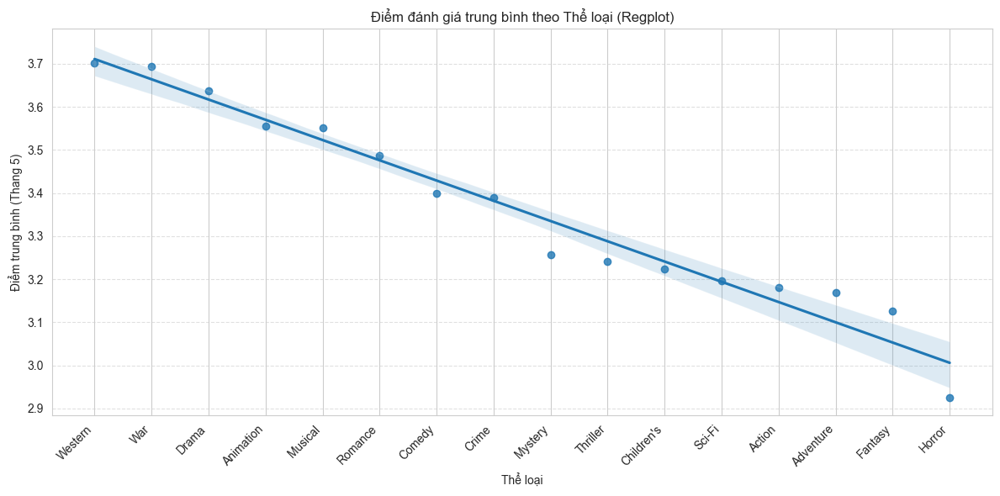

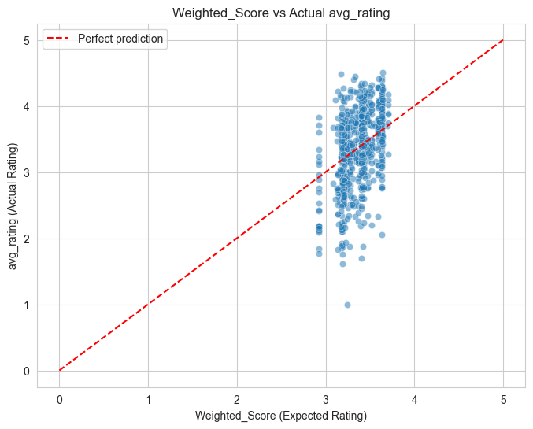

Phân tích về thể loại cho thấy sự phân hóa sâu sắc trong thị hiếu khán giả. Các thể loại như Film-Noir, Documentary và War luôn nằm trong top đầu về điểm số trung bình, phản ánh sự trân trọng của người xem đối với các tác phẩm giàu tính hiện thực và nghệ thuật. Ngược lại, Horror và Action thường nằm ở đáy bảng xếp hạng điểm số. Việc sử dụng chỉ số Weighted Score (điểm trung bình có trọng số) trong mô hình Random Forest sau đó đã chứng minh đây là biến quan trọng nhất, giúp dự đoán chính xác kỳ vọng rating dựa trên danh sách thể loại của phim.

Thời lượng phim:

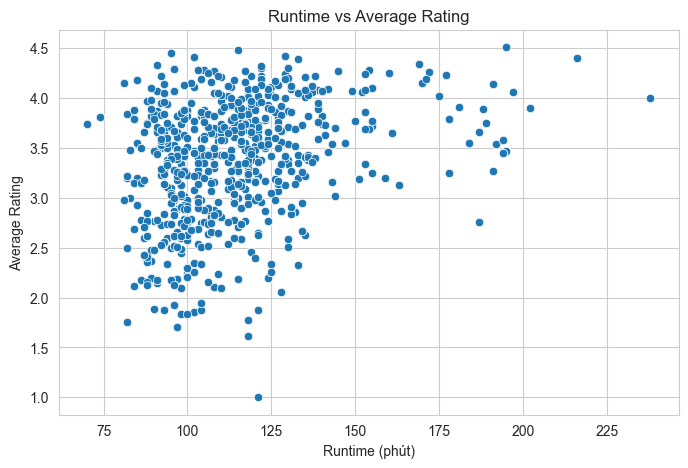

Về thời lượng, mặc dù hệ số tương quan không quá lớn, nhưng xu hướng chung là tích cực. Các bộ phim dài cho phép phát triển tuyến nhân vật và cốt truyện sâu sắc hơn, từ đó dễ dàng chạm đến cảm xúc khán giả hơn so với các tác phẩm ngắn hời hợt. Phân tích hồi quy cho thấy cứ mỗi phút tăng thêm, điểm rating có xu hướng nhích nhẹ, nhưng sự cộng hưởng này trở nên rõ rệt nhất khi so sánh giữa nhóm phim "Rất dài" và nhóm "Ngắn".

### 3. Các yếu tố nhân sự và thời gian

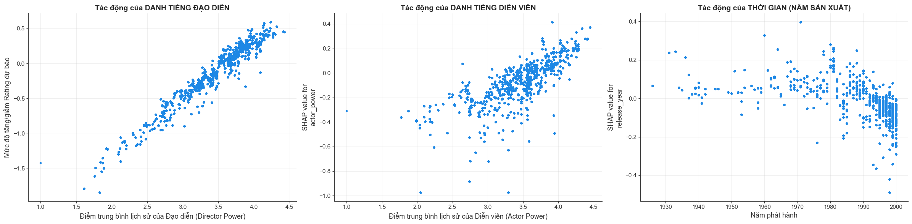

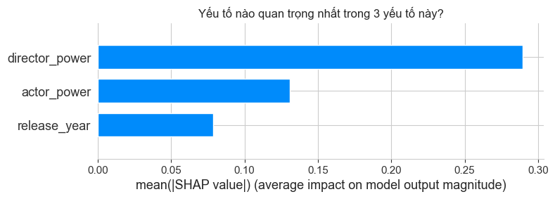

Phân tích SHAP từ mô hình XGBoost đã lượng hóa chính xác quyền lực của ê-kíp sản xuất. Director Power (Sức mạnh đạo diễn) áp đảo hoàn toàn với mức độ đóng góp gấp 2.5 lần so với diễn viên và gấp 5 lần so với năm sản xuất. Điều này khẳng định đạo diễn chính là "kiến trúc sư trưởng" quyết định thành bại của bộ phim. Yếu tố thời gian (Release Year) có xu hướng tác động tiêu cực nhẹ đối với các phim hiện đại, phản ánh tâm lý hoài cổ và sự khắt khe hơn của khán giả đối với điện ảnh đương đại.

#### Ma trận cộng hưởng và Phân tích ngoại lệ

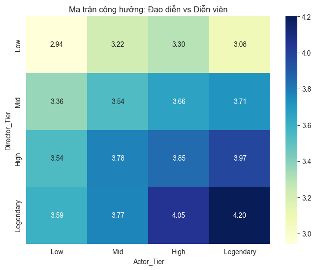

Ma trận cộng hưởng giữa Đạo diễn và Diễn viên đã làm sáng tỏ mối quan hệ tương hỗ này. Một đạo diễn đẳng cấp (High-tier) có thể đảm bảo mức điểm sàn an toàn cho phim ngay cả khi không có ngôi sao. Ngược lại, một diễn viên huyền thoại cũng không thể "gánh" nổi một bộ phim nếu đạo diễn quá kém. Sự kết hợp hoàn hảo nhất luôn đến từ cả hai phía, với mức điểm dự báo lên tới 4.20 cho cặp đôi Đạo diễn và Diễn viên cùng thuộc nhóm Huyền thoại.

+ Phân tích 2 nhóm ngoại lệ dựa trên độ lệch:

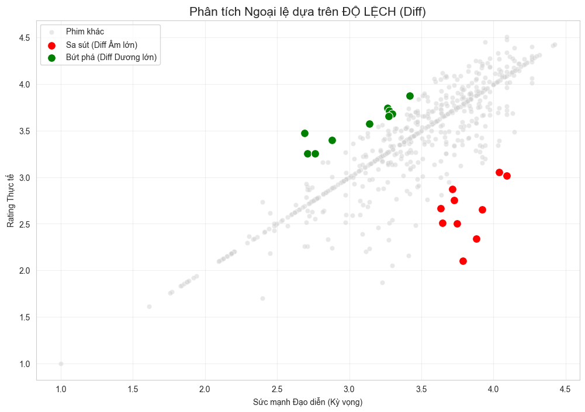

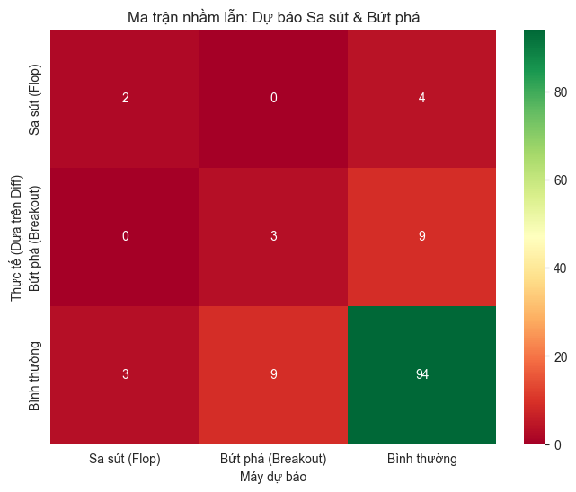

Cuối cùng, phân tích ngoại lệ giúp nhận diện hai nhóm phim đặc biệt: "Sa sút" và "Bứt phá". Nhóm sa sút thường là các tác phẩm của đạo diễn lớn nhưng gây thất vọng nặng nề do kỳ vọng quá cao (như bản remake Psycho). Ngược lại, nhóm bứt phá là sân chơi của các đạo diễn trẻ hoặc ít tên tuổi, đặc biệt trong dòng phim kinh dị, nơi kịch bản đột phá có thể giúp họ vượt qua rào cản danh tiếng. Tuy nhiên, mô hình dự báo vẫn gặp khó khăn trong việc phân loại chính xác hai nhóm này do sự mất cân bằng dữ liệu, khi đa số các bộ phim vẫn nằm ở mức chất lượng bình thường như dự đoán.